# HALO v1 --- Peer-to-Peer File Sharing

HALO is a native Android application for sharing a single file directly
between nearby Android devices on the same local network. It uses Java
TCP sockets for file transfer, Android NSD/mDNS for nearby-device
discovery, and QR codes as an alternative pairing method

> **Project scope:** HALO v1 focuses on one sender, one receiver, and
> one file per transfer. It does not require a cloud account or a
> central file-storage server

## Features

-   **Direct TCP file transfer** between Android devices on a local
    network
-   **Nearby device discovery** using Android Network Service Discovery
    (NSD/mDNS)
-   **QR pairing** to connect using encoded connection details
-   **Receiver approval** with Accept / Decline before file data is
    sent
-   **Transfer progress** based on the transfer's byte counts
-   **Completion confirmation** so the sender can distinguish bytes sent
    from a completed receive
-   **Cancellation and failure handling** for interrupted transfers
-   **Sequential transfers** so users can return home and start another
    transfer after a completed or cancelled attempt
-   **Native Android UI** built with Kotlin and Jetpack Compose

## Tech Stack

  Area                 Technology
  -------------------- ----------------------------------------
  Android app          Kotlin
  UI                   Jetpack Compose, Material 3
  File transfer        Java TCP sockets
  Nearby discovery     Android NSD / mDNS
  Pairing              QR code
  File selection       Android Storage Access Framework (SAF)
  Build                Gradle
  Java/Kotlin target   17

## How It Works

``` text
Sender                         Receiver
  |                                |
  |---- Discover via NSD ----------|
  |       OR scan QR               |
  |                                |
  |---- TCP connection request --->|
  |---- Transfer request --------->|
  |                                | Show file details
  |                                | Accept or Decline
  |<----------- ACCEPT ------------|
  |                                |
  |---- File metadata/data ------->|
  |                                | Receive and save file
  |<---- Completion confirmation -|
  |                                |
  | Transfer complete              | File received
```

If the receiver declines or the connection fails, the transfer should
stop without being reported as successful. The app is designed to clean
up the active transfer resources and allow another attempt

## Requirements

-   Android Studio
-   Android SDK compatible with the project configuration
-   JDK 17
-   Two or more Android devices for end-to-end testing
-   Devices connected to the same Wi-Fi/local network for typical LAN
    transfers

Actual behavior may depend on Android version, network configuration,
and device permissions. Some Wi-Fi networks isolate connected clients
and prevent direct device-to-device communication

## Run Locally

1.  Clone or download this repository
2.  Open the project in Android Studio
3.  Allow Gradle sync to finish
4.  Connect an Android device or start an emulator
5.  Build and run the app
6.  Install and run HALO on a second Android device for real transfer
    testing
7.  Grant any permissions requested by the app and keep both devices on
    a network that allows local device communication

> The exact build variant and run configuration depend on the
> repository's Gradle setup

## Basic Usage

### Send a file

1.  Open HALO and choose **Send**
2.  Discover nearby receivers or use QR pairing
3.  Select exactly one receiver
4.  Select one file
5.  Tap **Send File**
6.  Wait for the receiver to accept the request
7.  Monitor transfer progress and wait for completion confirmation

### Receive a file

1.  Open HALO and choose **Receive**
2.  Start listening or display the QR code, depending on the available
    pairing flow
3.  Review the incoming file request
4.  Choose **Accept** or **Decline**
5.  If accepted, keep the app available until the transfer completes.

## Current Scope and Limitations

HALO v1 intentionally keeps the transfer flow small and understandable:

-   One file per transfer
-   One selected receiver per transfer
-   No cloud storage or account system
-   No transfer-history feature
-   Cancelled transfers restart from the beginning; resumable transfers
    are not part of v1
-   Transfers require a reachable local endpoint. Network isolation,
    firewalls, or a receiver that is no longer listening can prevent a
    connection

## Testing Checklist

Test on physical Android devices, not only an emulator

-   [ ] Small file transfer succeeds
-   [ ] Large file progress updates and reaches completion
-   [ ] Receiver accepts a request
-   [ ] Receiver declines a request and no file data is transferred
-   [ ] Receiver cancels during transfer and the sender stops
-   [ ] Sender disconnects during transfer and the receiver does not
    report success
-   [ ] An incomplete transfer is not shown as a completed file
-   [ ] A new transfer can be started after success
-   [ ] A new transfer can be started after cancellation or failure
    without restarting the app
-   [ ] NSD discovery works after a failed transfer
-   [ ] QR pairing works after a failed transfer
-   [ ] When multiple receivers are discovered, only the selected
    receiver gets the request

Mark a test complete only after verifying it on the current build

## Architecture Overview

The app separates the user interface, transfer state, discovery, and TCP
transfer responsibilities

``` text
Compose UI
   |
TransferViewModel / TransferState
   |
   +---- NSD Discovery / QR Pairing
   |              |
   |         Selected endpoint
   |              |
   +-------- TCP Sender / Receiver
                  |
            File streams / SAF
```

Relevant existing components may include `TcpSender`, `TcpReceiver`,
`FileMetadata`, `NsdDiscoveryManager`, `TransferViewModel`,
`TransferState`, and `MainActivity`. Names may vary if the
implementation has changed

## Security and Privacy Notes

-   HALO is designed for direct local-network transfers rather than
    cloud storage.
-   Only accept requests from devices you intend to receive files from.
-   A local network is not automatically a trusted network; use HALO on
    networks you trust.
-   Before public distribution, review input validation, transfer-size
    limits, protocol validation, permissions, and the handling of
    untrusted files.
-   Do not describe the app as production-secure until those areas have
    been reviewed and tested.

## Screenshots
## Screenshots

### App Screens

<table>
  <tr>
    <td align="center"><strong>Home</strong></td>
    <td align="center"><strong>Pick File</strong></td>
    <td align="center"><strong>File Selected</strong></td>
    <td align="center"><strong>Searching</strong></td>
  </tr>
  <tr>
    <td>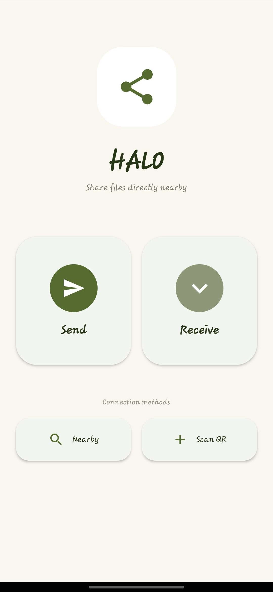</td>
    <td>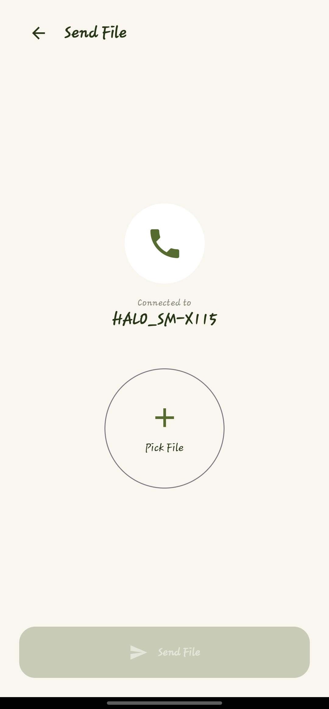</td>
    <td>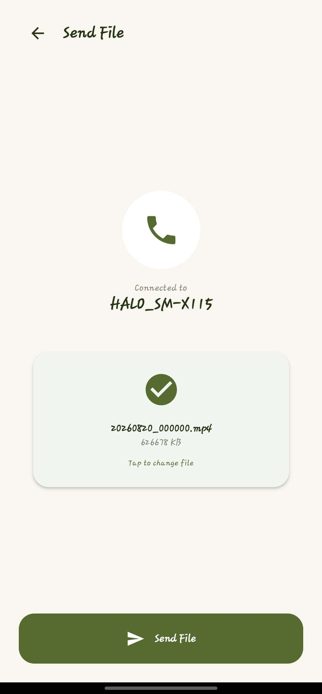</td>
    <td>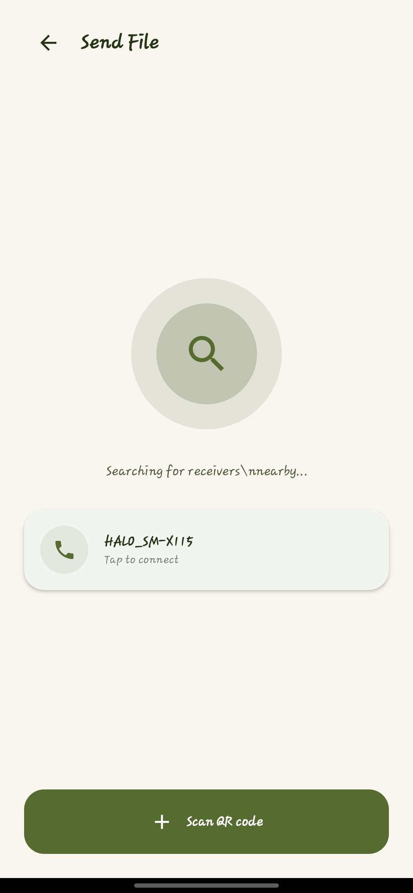</td>
  </tr>
</table>

### File Transfer

<table>
  <tr>
    <td align="center"><strong>Sending</strong></td>
    <td align="center"><strong>Waiting for Response</strong></td>
    <td align="center"><strong>Sent Successfully</strong></td>
    <td align="center"><strong>Transfer Failed</strong></td>
  </tr>
  <tr>
    <td>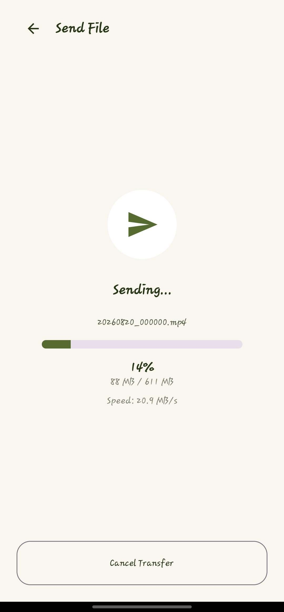</td>
    <td>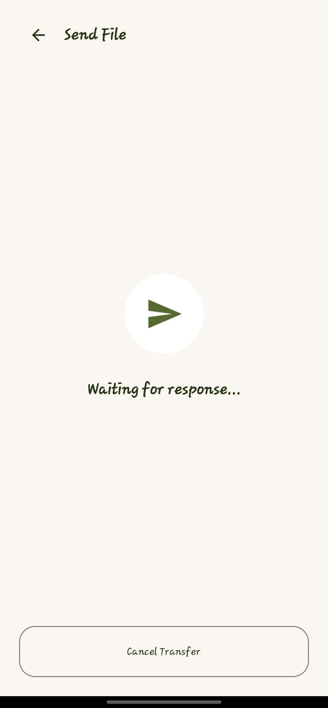</td>
    <td>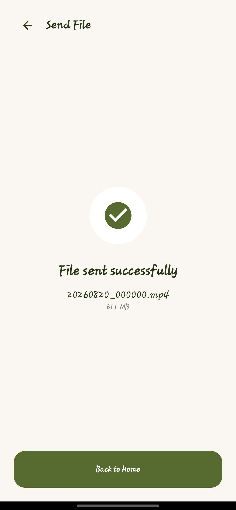</td>
    <td>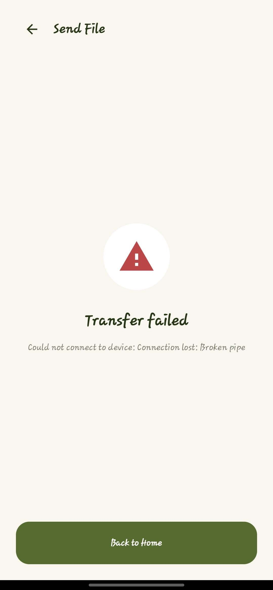</td>
  </tr>
</table>

### Receiver

<table>
  <tr>
    <td align="center"><strong>Incoming Request</strong></td>
    <td align="center"><strong>File Received</strong></td>
    <td align="center"><strong>Transfer Complete</strong></td>
    <td align="center"><strong>QR Code</strong></td>
  </tr>
  <tr>
    <td>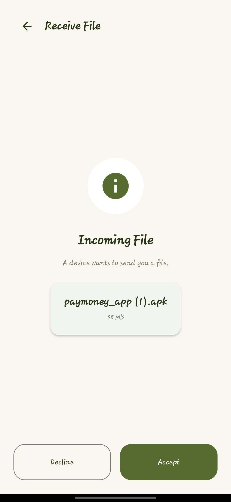</td>
    <td>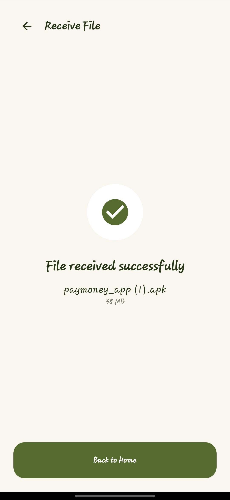</td>
    <td>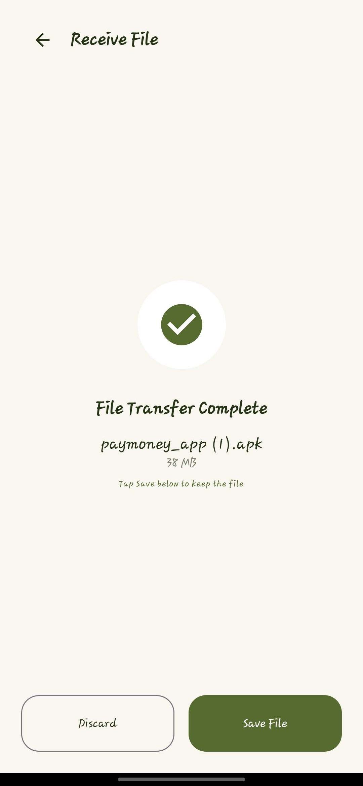</td>
    <td>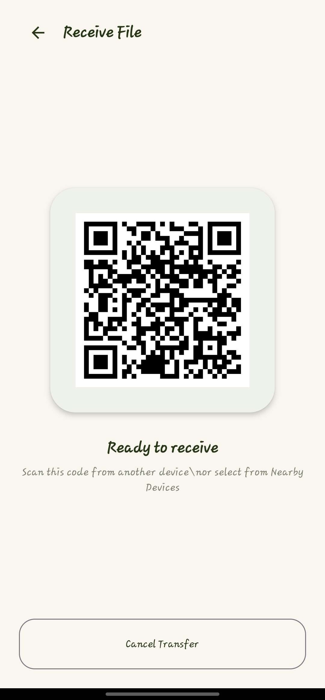</td>
  </tr>
</table>

### QR Pairing

<table>
  <tr>
    <td align="center"><strong>Scan QR</strong></td>
  </tr>
  <tr>
    <td>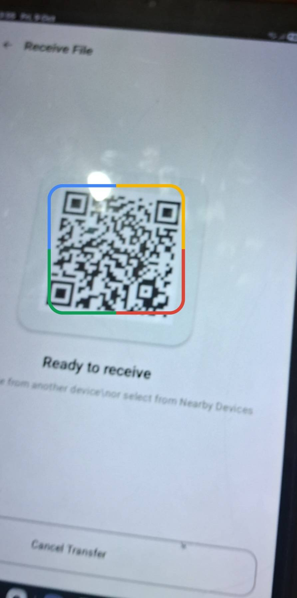</td>
  </tr>
</table>


## Future Improvements

Potential future work, outside the current v1 scope:

-   Resumable transfers
-   Multi-file transfer queue
-   Additional transfer-integrity verification
-   More comprehensive automated and device testing

## Author

**Vivek Yadav**

Built as an Android networking project to explore TCP sockets, local
device discovery, QR-based pairing, and reliable file-transfer flows

------------------------------------------------------------------------

**HALO v1** --- direct file sharing, one transfer at a time
